test locally docker build
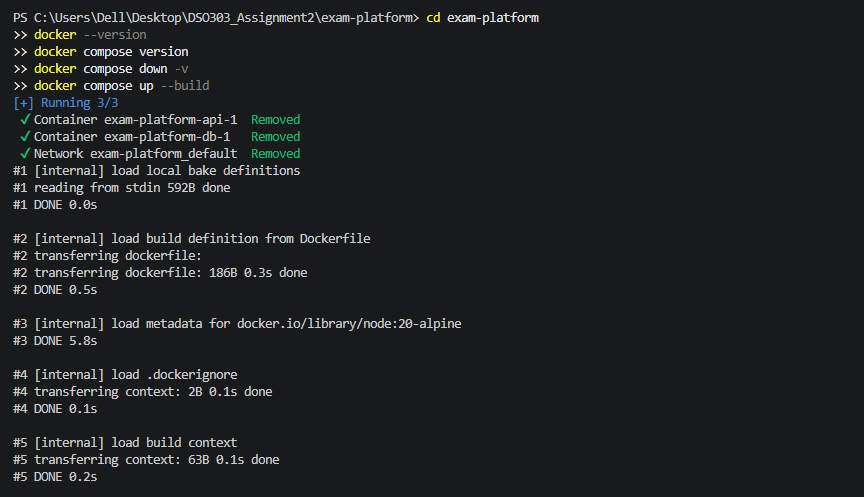

local host 8081
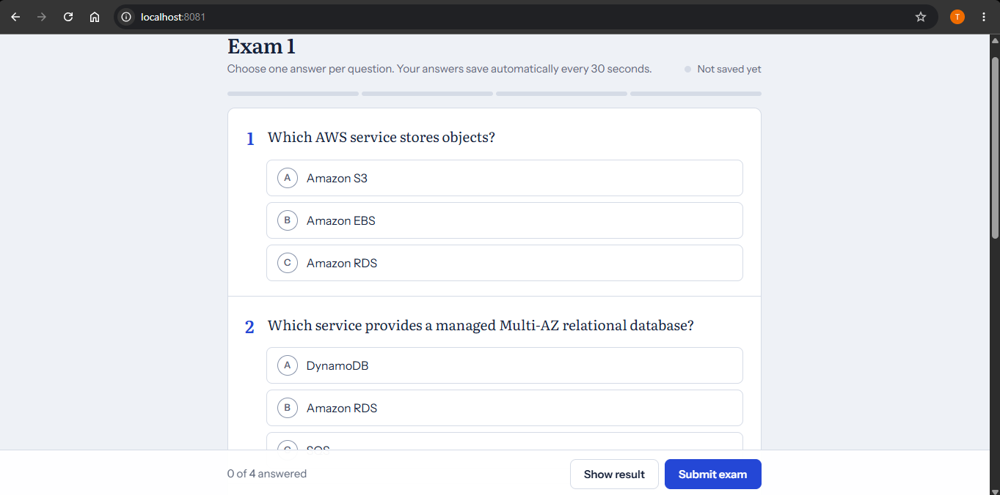

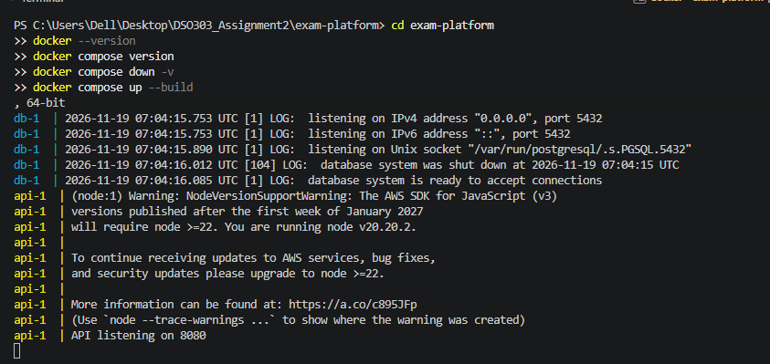

Create the GitHub repo
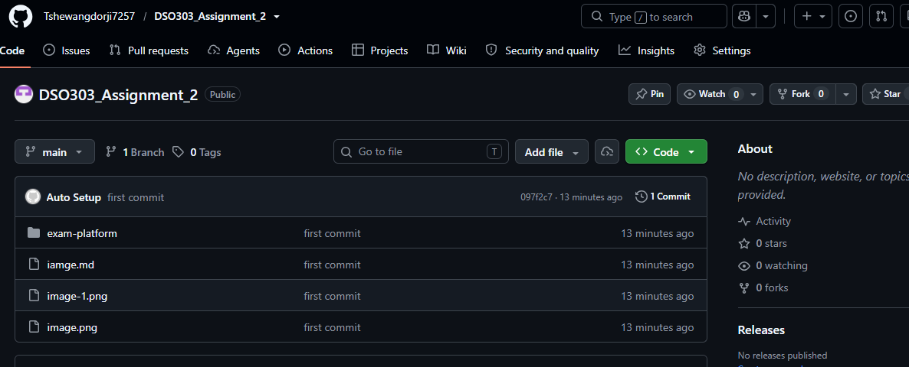

Validate the Terraform
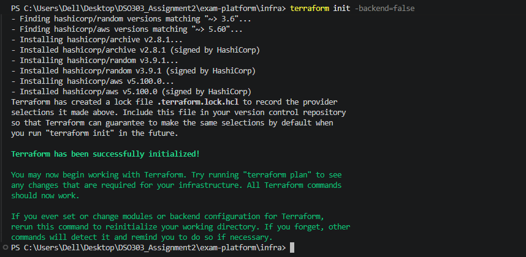
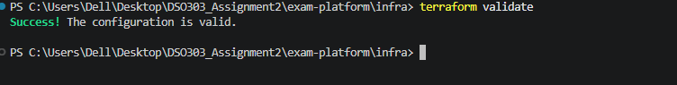

1f. Check your AWS access. This decides what we do in Step 2.
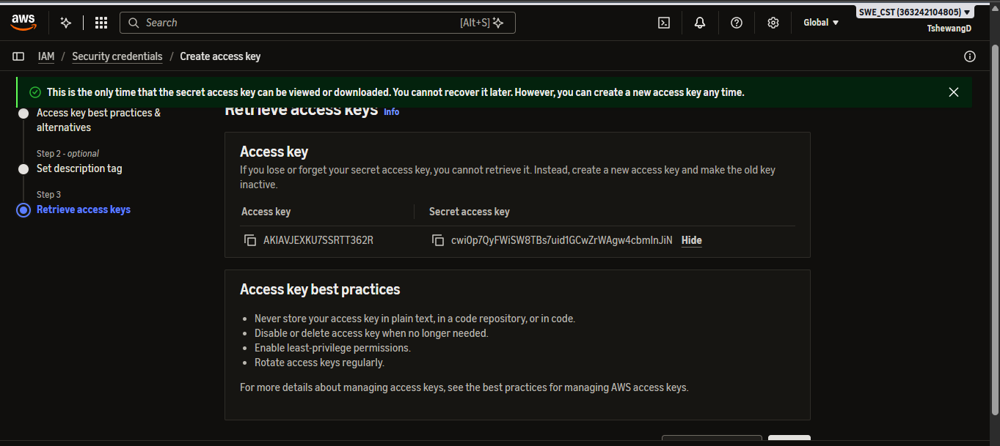
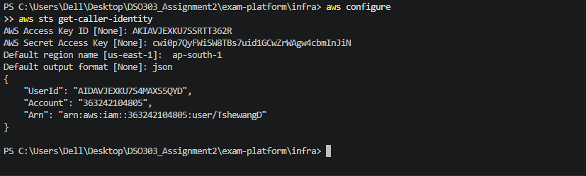
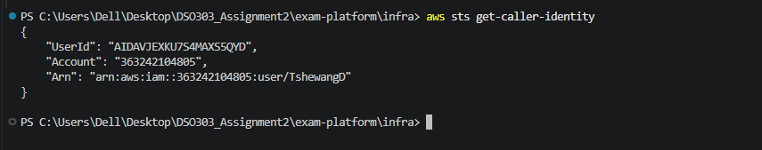

Step 2: Deploy
2a. Check the region setting. Your region line had a leading space.
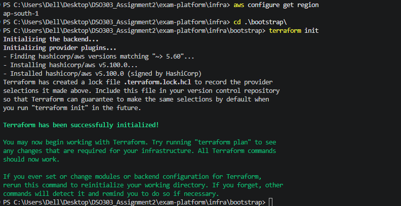

2b. Bootstrap (run once; it creates the state bucket and the GitHub login role):
Import the bucket using us-east-1
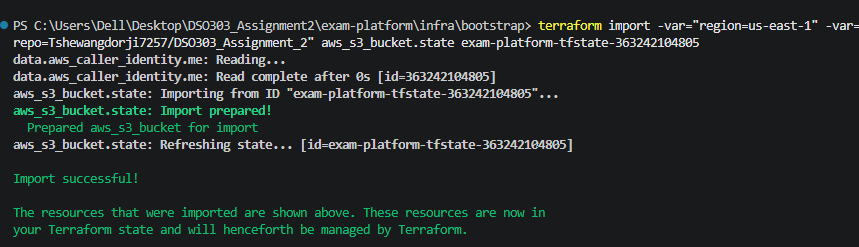

Import GitHub OIDC
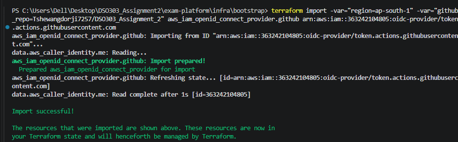

verify
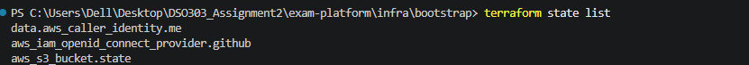

Apply the changes
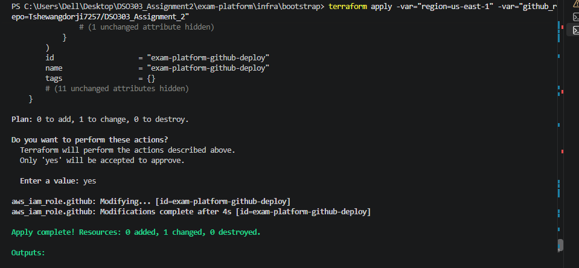

verify
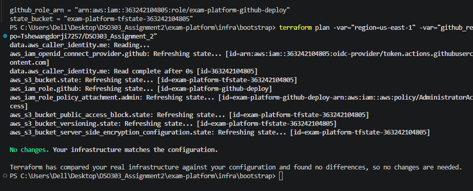

2c. Add the GitHub settings. In your repo, go to Settings → Secrets and variables → Actions.

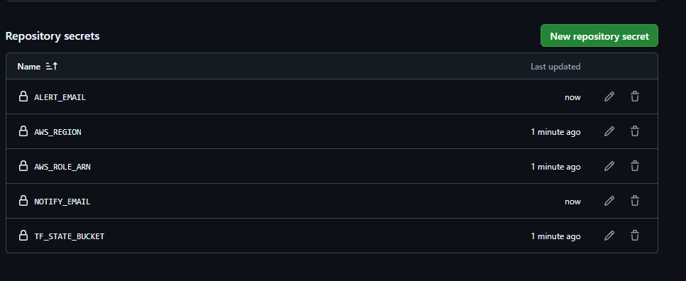